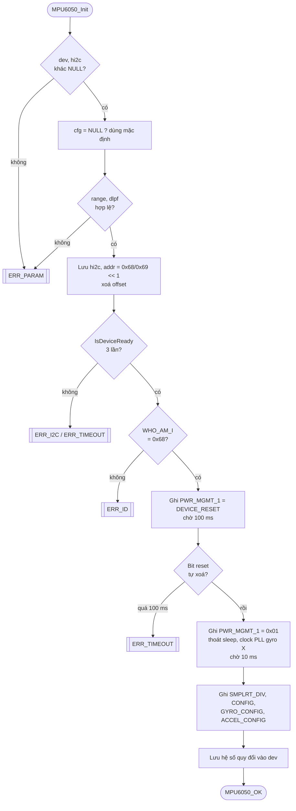

# Quy trình implement hàm `MPU6050_Init`

Tài liệu mô tả **thứ tự và lý do** của từng bước khi viết hàm khởi tạo cảm biến MPU6050
qua I2C (STM32 HAL). Code thật nằm ở `Drivers/MPU6050/Src/mpu6050.c`.

## 1. Mục tiêu và hợp đồng của hàm

| Mục | Nội dung |
|---|---|
| Việc làm | Kiểm tra cảm biến có mặt, reset, đánh thức, cấu hình dải đo / bộ lọc / tốc độ lấy mẫu |
| Gọi khi nào | Một lần lúc khởi động, **sau** `MX_I2C1_Init()` |
| Trả về | `MPU6050_OK` hoặc mã lỗi của bước bị hỏng |
| Phụ thuộc | `HAL_I2C_*` (đã cấu hình), `HAL_Delay`, `HAL_GetTick` |
| Lưu ý | Chặn ~110 ms (có `HAL_Delay`); không gọi trong vòng lặp thời gian thực |

```c
MPU6050_Status MPU6050_Init(MPU6050_t *dev, I2C_HandleTypeDef *hi2c,
                            uint8_t ad0, const MPU6050_Config_t *cfg);
```

## 2. Chuẩn bị trước khi viết

1. **Đọc datasheet / register map** của MPU6050, ghi lại các thanh ghi dùng đến (mục 3).
2. **Định nghĩa mã lỗi** (`MPU6050_Status`): `OK`, `ERR_PARAM`, `ERR_I2C`, `ERR_TIMEOUT`, `ERR_ID`.
3. **Viết hàm đọc/ghi thanh ghi dùng chung** (`reg_read`, `reg_write`) bọc `HAL_I2C_Mem_Read/Write`
   và đổi `HAL_StatusTypeDef` sang `MPU6050_Status` (`hal_to_status`). Mọi bước sau chỉ gọi hai hàm này.
4. **Định nghĩa cấu hình** (`MPU6050_Config_t`) và cấu hình mặc định (`MPU6050_CONFIG_DEFAULT`).
5. **Chốt kiểu dữ liệu `MPU6050_t`** (handle I2C, địa chỉ, hệ số quy đổi, offset).

## 3. Thanh ghi sử dụng

| Thanh ghi | Địa chỉ | Giá trị ghi | Ý nghĩa |
|---|---|---|---|
| `WHO_AM_I` | `0x75` | (đọc) phải bằng `0x68` | Xác nhận đúng chip |
| `PWR_MGMT_1` | `0x6B` | `0x80` rồi `0x01` | bit7 = `DEVICE_RESET`; bit6 = `SLEEP`; bit2:0 = `CLKSEL` (1 = PLL theo gyro X) |
| `SMPLRT_DIV` | `0x19` | `sample_rate_div` | Tốc độ mẫu = gyro_rate / (1 + div) |
| `CONFIG` | `0x1A` | `dlpf` (0..6) | Bộ lọc thông thấp số (DLPF) |
| `GYRO_CONFIG` | `0x1B` | `gyro_range << 3` | `FS_SEL` ở bit 4:3: ±250 / 500 / 1000 / 2000 °/s |
| `ACCEL_CONFIG` | `0x1C` | `accel_range << 3` | `AFS_SEL` ở bit 4:3: ±2 / 4 / 8 / 16 g |

Hệ số quy đổi (LSB trên đơn vị):

| Dải | Accel (LSB/g) | | Dải | Gyro (LSB/°/s) |
|---|---|---|---|---|
| ±2 g | 16384 | | ±250 °/s | 131 |
| ±4 g | 8192 | | ±500 °/s | 65.5 |
| ±8 g | 4096 | | ±1000 °/s | 32.8 |
| ±16 g | 2048 | | ±2000 °/s | 16.4 |

Tốc độ mẫu: gyro output rate là **8 kHz** khi DLPF = 0, và **1 kHz** khi DLPF ≥ 1.
Mặc định (DLPF 44 Hz, div = 9) cho 1000 / (1 + 9) = **100 Hz**.

## 4. Lưu đồ



Mọi thao tác I2C trong lưu đồ đều có thể trả lỗi; khi đó hàm **thoát ngay** với mã lỗi tương ứng.

## 5. Các bước implement

### Bước 1. Kiểm tra tham số (fail fast)

```c
if (dev == NULL || hi2c == NULL) return MPU6050_ERR_PARAM;
if (cfg == NULL) cfg = &def;                       /* def = cấu hình mặc định */
if ((unsigned)cfg->accel_range > MPU6050_ACCEL_16G ||
    (unsigned)cfg->gyro_range  > MPU6050_GYRO_2000DPS ||
    (unsigned)cfg->dlpf        > MPU6050_DLPF_5HZ) return MPU6050_ERR_PARAM;
```

Ép `(unsigned)` để bắt luôn giá trị âm. Kiểm tra **trước** khi chạm vào phần cứng.

### Bước 2. Lưu thông tin thiết bị

```c
dev->hi2c = hi2c;
dev->addr = (uint8_t)((ad0 ? 0x69 : 0x68) << 1);   /* HAL cần địa chỉ 8 bit */
/* xoá offset calibrate về 0 */
```

### Bước 3. Kiểm tra cảm biến có mặt

```c
HAL_I2C_IsDeviceReady(hi2c, dev->addr, 3U, MPU6050_I2C_TIMEOUT_MS);
reg_read(dev, MPU6050_REG_WHO_AM_I, &id, 1U);
if (id != MPU6050_WHO_AM_I_VALUE) return MPU6050_ERR_ID;
```

Phân biệt hai loại lỗi: **không có phản hồi** (dây, nguồn, địa chỉ) và **sai chip** (`ERR_ID`).

### Bước 4. Reset

```c
reg_write(dev, MPU6050_REG_PWR_MGMT_1, MPU6050_PWR1_DEVICE_RESET);
HAL_Delay(100);
/* đọc lại PWR_MGMT_1 đến khi bit DEVICE_RESET tự xoá, timeout 100 ms */
```

Đưa mọi thanh ghi về mặc định để trạng thái chắc chắn, không phụ thuộc lần chạy trước.

### Bước 5. Đánh thức và chọn clock

```c
reg_write(dev, MPU6050_REG_PWR_MGMT_1, MPU6050_PWR1_CLKSEL_PLL_XG);   /* 0x01 */
HAL_Delay(10);
```

Sau reset chip đang ở chế độ **sleep** (đọc dữ liệu ra 0). Ghi `0x01` xoá bit SLEEP
và dùng PLL của gyro X làm nguồn clock (ổn định hơn dao động nội).

### Bước 6. Ghi cấu hình đo

```c
reg_write(dev, MPU6050_REG_SMPLRT_DIV,   cfg->sample_rate_div);
reg_write(dev, MPU6050_REG_CONFIG,       (uint8_t)cfg->dlpf);
reg_write(dev, MPU6050_REG_GYRO_CONFIG,  (uint8_t)((unsigned)cfg->gyro_range  << 3));
reg_write(dev, MPU6050_REG_ACCEL_CONFIG, (uint8_t)((unsigned)cfg->accel_range << 3));
```

### Bước 7. Lưu hệ số quy đổi (cuối cùng)

```c
dev->accel_lsb_per_g  = accel_lsb[cfg->accel_range];
dev->gyro_lsb_per_dps = gyro_lsb[cfg->gyro_range];
return MPU6050_OK;
```

Đặt **sau cùng** để hệ số chỉ có giá trị khi mọi bước trước đã thành công.

## 6. Quy ước xử lý lỗi

- Sau mỗi thao tác I2C: `if (st != MPU6050_OK) return st;` (return sớm, không lồng `if`).
- Vòng chờ luôn có **timeout**, không dùng `while` vô hạn.
- Khi `Init` thất bại, `dev` có thể mới được ghi một phần: người gọi **không dùng** `dev` nếu không nhận `MPU6050_OK`.

## 7. Kiểm thử

| Tình huống | Kết quả mong đợi |
|---|---|
| `dev == NULL` hoặc `hi2c == NULL` | `MPU6050_ERR_PARAM` |
| `dlpf = 7` (ngoài phạm vi) | `MPU6050_ERR_PARAM` |
| Chưa nối cảm biến / sai địa chỉ AD0 | `ERR_I2C` hoặc `ERR_TIMEOUT` |
| Nối chip khác (WHO_AM_I ≠ 0x68) | `MPU6050_ERR_ID` |
| Cảm biến đúng | `MPU6050_OK`; đọc lại `CONFIG` = `dlpf`, `GYRO_CONFIG` = `range << 3` |
| Nằm phẳng sau `Init` + `Calibrate` | `az` ≈ 1 g, `ax`, `ay` ≈ 0, gyro ≈ 0 |
| Gọi `Init` hai lần liên tiếp | Vẫn `OK` (reset đưa về trạng thái sạch) |

## 8. Lỗi thường gặp

- Quên **thoát sleep**: dữ liệu luôn bằng 0.
- Quên dịch địa chỉ `<< 1`: `IsDeviceReady` không tìm thấy thiết bị.
- Dịch sai vị trí bit của `FS_SEL` / `AFS_SEL` (phải là bit 4:3).
- Đọc dữ liệu ngay sau reset, không chờ đủ thời gian.
- Dùng giá trị `sample_rate_div` mà quên rằng gyro rate là 8 kHz khi DLPF = 0.
- Quên kiểm tra giá trị trả về của `Init` trước khi dùng cảm biến.
